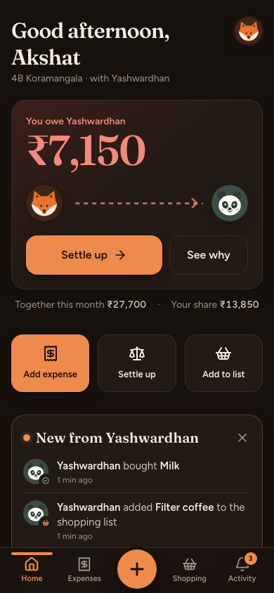

# Chai Bill

A home for two roommates: shared expenses, settling up without the awkwardness, a shopping list, and a
live feed of what's happening in the flat. Built for Bangalore flats, in rupees, with UPI.

It is built to be used every day by the two people in the flat, and to show how a small money product can
be made carefully: integer money, row-level security enforced in Postgres, realtime that respects the same
rules, and a design with a point of view.

<p align="center">
  
  
  
</p>
<p align="center">
  
  
  
</p>
<p align="center">
  
</p>

## What it does

- **Sign in** with an emailed link, pick a name and one of ten hand-drawn avatars, then start a flat or
  join one with a single-use invite code. The invite screen flips live the moment your roommate joins.
- **Home** answers "what's happening in our flat?": who owes whom (with an animated amount and a flowing
  arrow between your avatars), what's new from your roommate, recent expenses, what's left to buy, and
  recent activity.
- **Expenses**, shared or just yours. Add one in seconds: a big amount, a category (suggested from what
  you typed), who paid, and a split: equally, by exact amounts, or by percentage, with a live preview. The
  leftover paisa from a split goes to the payer. Edit, or delete with a confirm.
- **Settle up.** See the arithmetic behind the balance, record a payment of any amount (partial payments
  are normal) by UPI, cash or other, and watch the balance update on both phones. Settling in full gets a
  small celebration.
- **Shopping list** with a tactile feel: add with a quantity, tap to buy, swipe to remove, Undo from the
  toast, and see your roommate's additions appear as they happen.
- **Activity feed** with the kind of event, who did it, and a clear "New since your last visit" that is
  exactly right (see [DESIGN.md](docs/DESIGN.md)).
- **Light, dark or automatic**, a profile with your avatar's colours, and a layout designed separately for
  phones and desktop.

Currency is INR only. Budgets, bills, chores, analytics and receipt scanning are out of scope for v1.

## Architecture

```
Browser (Next.js client components + motion)
   │  server actions and RSC reads             Realtime (postgres_changes, with the user's token)
   ▼                                                  ▲
Next.js 15 App Router ── @supabase/ssr ──────────► Supabase
   │                                                ├─ Auth (magic link, PKCE)
   │ pure money engine   (src/lib/money)            ├─ Postgres + row-level security
   │ pure form parsers   (src/lib/*/form.ts)        ├─ triggers → activity_events
   ▼                                                └─ RPCs: create/join household, upsert_expense,
 one LiveProvider: toasts, "fresh" glow, refresh              update_profile, mark_activity_seen
```

- **Next.js 15 App Router, TypeScript, Tailwind 4.** Screens read data on the server. Interactive parts are
  small client components. Forms call server actions that validate with Zod and return a result.
- **Supabase.** Auth, Postgres, Realtime. The schema is plain SQL under `supabase/migrations` (no ORM).
- **Pure logic in `src/lib`.** Money, splits, balances, form parsing, categories, avatars and the activity
  wording have no framework or database imports, so they're unit tested directly. The expense form's live
  preview and the server save call the same parser, so the numbers shown are the numbers stored.
- **One realtime connection** for the whole signed-in app (`LiveProvider`). A change by your roommate
  refreshes the server data, shows a toast with their avatar, and makes the changed item glow.
- **Design system** in `src/app/globals.css` and `src/components/ui`, documented in
  [docs/DESIGN.md](docs/DESIGN.md). A live reference is at `/design` in development.

## Money rules

All money is an integer number of paise. There are no floats in storage or in the money engine.

- **Equal split.** Each person gets `floor(total / n)`. The remainder (0 to n-1 paise) goes to the payer.
- **Exact amounts.** Must sum to the total exactly. Nothing is rounded for you.
- **Percentages.** Stored as basis points (33.33% = 3333), summing to 10000. Each share is
  `floor(total × bp / 10000)` computed with BigInt, and the remainder goes to the payer.
- **Balances.** For each member: `paid − owed + sent − received`, over shared expenses and non-deleted
  settlements. The nets always sum to zero (tested). The Settle up screen shows each term.
- **Settle-up plan.** A greedy match of the largest creditor with the largest debtor, ties broken by id.
- **Overpayment** is allowed and flips the sign. The sheet warns, but the database doesn't reject it,
  because enforcing it would race with concurrent writes.
- Balances are always recomputed from rows, never stored as a running total.

## Data and security

Every table has row-level security enabled, and `anon` has no privileges. The rules live in Postgres, so
they hold whatever the UI does.

- A SECURITY DEFINER helper `is_household_member()` backs every policy and avoids recursive evaluation.
- Households and memberships are created only through RPCs. The two-member cap is enforced in
  `join_household()`. Invite codes are single use and expire after seven days.
- **Profiles** (name and avatar) are readable by you and by people you share a flat with, and written only
  through `update_profile()`, which also keeps your name in the flat in step.
- Personal expenses and their shares are visible only to their creator. Shared rows belong to the flat.
- A settlement can only be recorded by its payer.
- Every expense must have shares that sum to its total, checked by a deferred constraint trigger at COMMIT.
  Expenses are written with `upsert_expense()`, which replaces the shares in one transaction.
- The activity feed can be written only by triggers. It records adds, **edits** and deletes of expenses,
  payments and shopping items.
- **Unread tracking** is a per-person marker that only ever moves forward, clamped to now, and only for the
  caller (`mark_activity_seen()`).
- Nothing that affects a balance is hard-deleted. Expenses and settlements are soft-deleted.

## Running it locally

Requirements: Node 20+, Docker, and the Supabase CLI.

```bash
npm install
supabase start               # Postgres, Auth, Realtime and Mailpit in Docker
cp .env.example .env.local   # then set NEXT_PUBLIC_SUPABASE_ANON_KEY from `supabase status -o env`
npm run dev                  # http://localhost:3000
```

Sign-in emails go to a local inbox at http://127.0.0.1:54324. Open it to click the link.
`supabase migration up` applies new migrations to the local database.

## Tests

```bash
npm test                     # unit tests: money engine, parsers, avatars, categories, time, activity wording
npm run lint
npm run test:e2e             # Playwright: builds the app, starts it, drives it in Chromium
psql "$DB_URL" -f supabase/tests/rls.sql                          # RLS and RPC checks
psql "$DB_URL" -f supabase/tests/rls_settlements_shopping.sql     # settlements, shopping, feed
psql "$DB_URL" -f supabase/tests/redesign.sql                     # profiles, unread marker, categories, edits
psql "$DB_URL" -f supabase/tests/expense_rpc.sql                  # atomic expense writes
psql "$DB_URL" -f supabase/tests/commit_path.sql                  # deferred share check at COMMIT
```

`$DB_URL` is the `DB_URL` printed by `supabase start`. The SQL scripts run in a rolled-back transaction or
clean up after themselves (a few errors in their output are the rejections they expect).

The end-to-end suite covers onboarding and invite codes, every expense form path (equal, exact and
percentage splits, the odd-paisa rule, category suggestion, edit, delete, personal privacy), balances and
payments live on both screens, the shopping list with undo, the activity feed and unread badge, profile
and theme, sheet focus handling, and a sweep of every screen at five widths for sideways scroll. The
sign-in tests send many emails, so the local auth rate limits in `supabase/config.toml` must be raised
while running them (the committed values are the production-safe ones).

## Status

Milestones M0 to M6 are built, plus the full UI/UX redesign. Deployment is not decided yet. Known gaps:

- If two people edit the same expense at the same moment, the last save wins. There's no conflict check.
- The theme choice is remembered on the device, not on the account.
- Expense edit history isn't kept; the activity feed records that an edit happened.
- One household per person, with the two-member cap enforced in the database.

## Repository layout

```
docs/SPEC.md                 product scope, money rules, data model, milestones
docs/DESIGN.md               the design system and the reasoning behind it
supabase/migrations/         schema, RLS, RPCs, triggers (applied in order)
supabase/tests/              SQL checks for RLS, RPCs, the commit path and the redesign
src/app/                     routes: (app) is the signed-in shell, onboarding/, login/, design/ (dev only)
src/components/ui/           buttons, fields, sheet, toast, segmented, money, skeletons, confetti
src/components/avatar/       the ten avatars, the picker, the preview stage
src/components/brand/        logo and illustrations
src/components/{expenses,balances,shopping,activity,household,nav,live,theme}/   feature components
src/lib/money/               money engine: parsing, splits, balances, settle-up, summary
src/lib/{expenses,settlements,shopping,activity}/   pure form parsers and wording
src/lib/data/                server loaders: the signed-in context and per-screen queries
src/lib/{avatars,categories,time,haptics}.ts        shared pure helpers
e2e/                         Playwright specs and helpers
```
