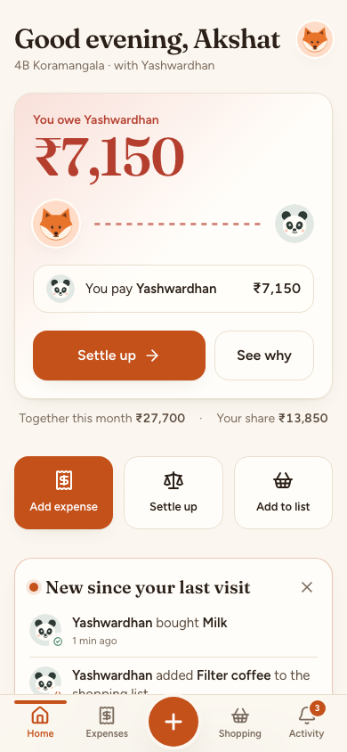
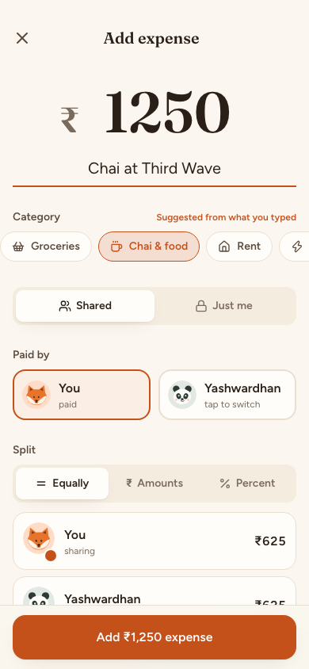
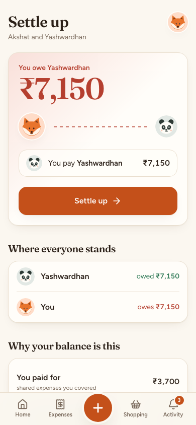
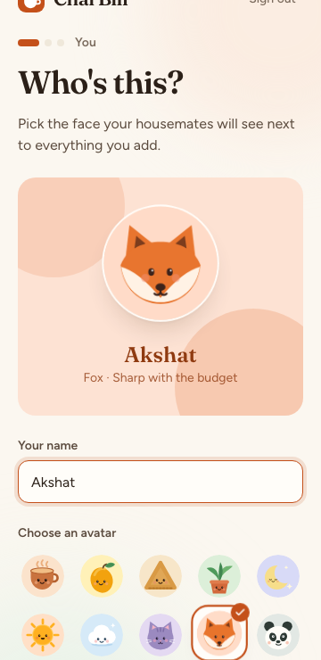
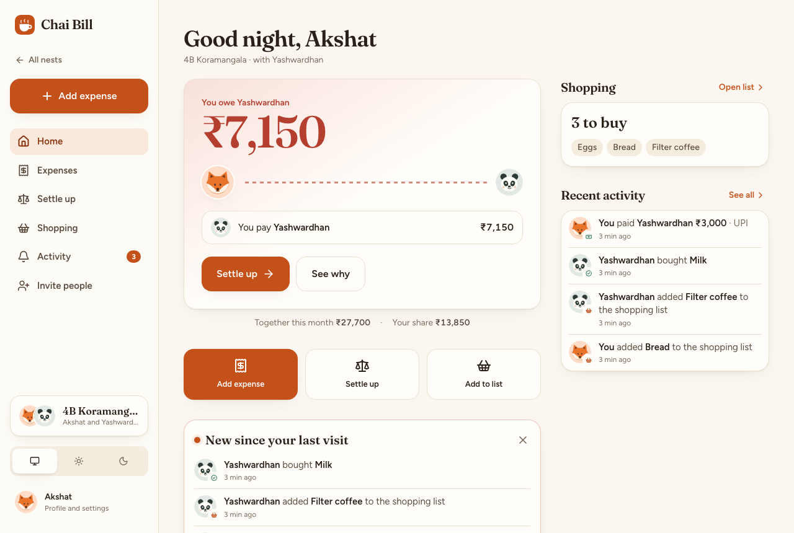

<div align="center">

# ☕ Chai Bill

**The shared ledger for your flat.**<br>
Split expenses, settle up without the awkwardness, and keep the shopping list in one place. Made for two roommates, in rupees, with UPI.

[](LICENSE)
[](CONTRIBUTING.md)
[](https://nextjs.org)
[](https://www.typescriptlang.org)
[](https://supabase.com)

<br>





</div>

<br>

Chai Bill is **open source** and **open to contributions**. If you've ever argued about who paid for the
wifi, you'll know why it exists. See [Contributing](#-contributing) to join in.

## Why Chai Bill

Most expense apps are built for groups, trips and accountants. Chai Bill is built for the two people who
share a front door: it answers *"what's happening in our flat?"* the moment you open it.

- **Who owes whom, at a glance.** Two avatars, one arrow, one number. Tap once to settle up.
- **Quick enough to use daily.** Adding a chai bill takes seconds: type an amount, and you're nearly done.
- **Honest about money.** Everything is stored as integer paise. Splits never leak a paisa, and the leftover
  always lands somewhere predictable (with the payer).
- **Private where it counts.** Your personal expenses are invisible to your roommate, enforced in the
  database, not just hidden in the UI.
- **Alive.** When your roommate adds something, your screen updates, tells you who did it, and the new item
  glows. No refreshing.

## Features

<table>
<tr>
<td width="50%" valign="top">

### 💸 Expenses
- Shared or personal (personal is private to you)
- Split **equally**, by **exact amounts**, or by **percentage**, with a live preview
- Category suggested from what you type
- Edit, delete with confirmation, full details sheet

### 🤝 Settle up
- See the arithmetic behind the balance
- Record any amount: partial payments are normal
- UPI (with reference), cash or other
- A small celebration when you're all square

</td>
<td width="50%" valign="top">

### 🛒 Shopping list
- Instant adds, tap to buy, swipe to remove
- **Undo** from the toast
- See who added and who bought each item

### 🔔 Activity and live updates
- A feed of every expense, edit, payment and shopping change
- "New since your last visit" that is exactly right
- Toasts with your roommate's avatar as it happens

### 🎨 Made to be enjoyed
- Ten hand-drawn avatars, each with its own accent
- Light, dark or automatic theme
- Designed for phones first, and separately for desktop

</td>
</tr>
</table>

<div align="center">




<br><br>

</div>

## Tech stack

| Layer | Choice |
| --- | --- |
| App | [Next.js 15](https://nextjs.org) App Router, React 19, TypeScript (strict) |
| Styling | [Tailwind CSS 4](https://tailwindcss.com) with design tokens, [Fraunces](https://fonts.google.com/specimen/Fraunces) and [Figtree](https://fonts.google.com/specimen/Figtree) |
| Motion and icons | [motion](https://motion.dev), [lucide-react](https://lucide.dev) |
| Backend | [Supabase](https://supabase.com): Auth (magic links), Postgres, Realtime, row-level security |
| Validation | [Zod](https://zod.dev) at every boundary |
| Tests | [Vitest](https://vitest.dev) (unit), plain SQL (database), [Playwright](https://playwright.dev) (end to end) |

There is no ORM: the schema is plain SQL in [`supabase/migrations`](supabase/migrations), and it is the
source of truth.

## Getting started

You need **Node 20+**, **Docker**, and the **[Supabase CLI](https://supabase.com/docs/guides/cli)**.

```bash
git clone https://github.com/akshatmhjj/chai-bill.git
cd chai-bill
npm install

supabase start                 # Postgres, Auth, Realtime and a local inbox, all in Docker
cp .env.example .env.local     # then fill in the two values below
npm run dev                    # http://localhost:3000
```

`supabase start` prints what you need for `.env.local`. You can also run `supabase status -o env`:

```bash
NEXT_PUBLIC_SUPABASE_URL=http://127.0.0.1:54321        # API_URL
NEXT_PUBLIC_SUPABASE_ANON_KEY=...                      # ANON_KEY
```

**Signing in locally.** Chai Bill uses magic links, and local emails never leave your machine. Open the
inbox at **http://127.0.0.1:54324**, click the link, and you're in. Sign in as two different emails (in two
browsers or one normal and one private window) to play both roommates.

> **Heads up:** `supabase/config.toml` limits sign-in emails to 2 per hour, the safe value for
> production. When developing locally you'll hit that quickly. Raise `email_sent` (and
> `sign_in_sign_ups`, `token_verifications`) under `[auth.rate_limit]`, restart with `supabase stop && supabase start`,
> and avoid committing that change.

Schema changes live in `supabase/migrations`. `supabase migration up` applies new ones to your local
database, and `supabase db reset` rebuilds it from scratch.

### Scripts

| Command | What it does |
| --- | --- |
| `npm run dev` | Start the app in development, with a live design-system reference at `/design` |
| `npm run build` / `npm start` | Production build and server |
| `npm run lint` | ESLint |
| `npm test` | Unit tests (Vitest) |
| `npm run test:e2e` | End-to-end tests in Chromium (Playwright): builds the app and drives it |

## How the money works

Money is where apps like this go wrong quietly, so the rules are strict, small and tested.

- **Integer paise everywhere.** No floats in storage or in the money engine.
- **Equal split:** each person gets `floor(total / n)`. The leftover paise (0 to n−1) go to the payer.
- **Exact amounts** must add up to the total exactly. Nothing is rounded for you.
- **Percentages** are stored as basis points (33.33% = 3333) and must total 10000. Each share is
  `floor(total × bp / 10000)` using BigInt, and the remainder goes to the payer.
- **Balance** = `paid − owed + sent − received`, over shared expenses and non-deleted payments. Balances
  always sum to zero, and are always recomputed from rows, never stored.
- **Overpaying** is allowed and simply flips the balance. The app warns, but never blocks.
- **Nothing that changes a balance is hard-deleted.** Expenses and payments are soft-deleted.

The engine is pure TypeScript with no framework or database imports: see [`src/lib/money`](src/lib/money).

## Security model

Privacy is enforced where it can't be bypassed: in Postgres.

- Every table has **row-level security**, and `anon` has no access at all.
- Personal expenses are visible only to their creator. Shared data belongs to the flat's two members.
- A payment can only be recorded by the person who made it.
- Every expense's shares must add up to its total, checked by a deferred constraint at `COMMIT`.
- Households are created and joined only through RPCs; invite codes are single use, expire in 7 days, and a
  flat is capped at two people.
- The activity feed is written only by database triggers, so it can't be forged from the client.
- Realtime uses the same policies, so you only ever receive rows you could have read.

The database has its own test suite (see below) that proves these rules by trying to break them.

## Testing

```bash
npm test                          # unit tests: money, splits, parsers, avatars, time, wording
npm run lint
npx tsc --noEmit

# Database: RLS, RPCs and triggers, run against your local stack
DB_URL=$(supabase status -o env | grep '^DB_URL=' | cut -d'"' -f2)
for f in rls rls_settlements_shopping redesign expense_rpc commit_path; do
  psql "$DB_URL" -f supabase/tests/$f.sql
done

# End to end (needs Chromium: npx playwright install chromium)
npm run test:e2e
```

The SQL tests run in a rolled-back transaction or clean up after themselves; the handful of `ERROR` lines in
their output are the rejections they expect. The end-to-end suite signs in about 40 people, so raise the
local auth rate limits first (see the note above) and put them back afterwards. It covers onboarding,
every split path, balances and payments live on two screens, the shopping list, the unread badge, theme,
focus handling in sheets, and a sweep of every screen at six widths for sideways scrolling.

## Project structure

```
docs/                       SPEC.md (what and why) and DESIGN.md (the design system)
supabase/
  migrations/               schema, RLS, RPCs and triggers, applied in order
  tests/                    SQL tests for RLS, RPCs, triggers and the commit path
src/
  app/                      routes: (app)/ is the signed-in shell, plus login/ and onboarding/
  components/
    ui/                     buttons, fields, sheet, toast, segmented control, money, skeletons
    avatar/ brand/          the ten avatars, the picker, the logo and illustrations
    expenses/ balances/ shopping/ activity/ household/ nav/ live/ theme/
  lib/
    money/                  the money engine: parsing, splits, balances, settle-up
    expenses/ settlements/ shopping/ activity/    pure parsers and wording
    data/                   server loaders (the signed-in context, per-screen queries)
    avatars.ts categories.ts time.ts              shared pure helpers
e2e/                        Playwright specs
```

Where to read first: [`docs/SPEC.md`](docs/SPEC.md) for the product and data model,
[`docs/DESIGN.md`](docs/DESIGN.md) for the design system, and [`src/lib/money`](src/lib/money) for the heart
of the app.

## Deploying your own

Chai Bill runs well on [Vercel](https://vercel.com) with a [Supabase](https://supabase.com) project:

1. Create a Supabase project and link it: `supabase link --project-ref <ref>`.
2. Apply the schema: `supabase db push`.
3. In the Supabase dashboard, set the **Site URL** and add `https://<your-domain>/auth/callback` to the
   **Redirect URLs** (Authentication → URL Configuration).
4. Import the repo into Vercel and set `NEXT_PUBLIC_SUPABASE_URL` and `NEXT_PUBLIC_SUPABASE_ANON_KEY`
   (the project URL and the anon or publishable key).
5. For real use, configure a custom SMTP provider in Supabase: the built-in mailer has a very low hourly limit.

## 🤝 Contributing

**Contributions are very welcome.** Bug reports, ideas, design feedback, translations, tests and code all
help. You don't need to ask first: for anything beyond a small fix, though, it's worth opening an issue so
we can agree on the shape of it before you spend time.

1. **Fork** the repo and create a branch: `git checkout -b feat/your-idea`.
2. **Get it running** with the steps above.
3. **Make your change.** Add or update tests alongside it.
4. **Check it:** `npm run lint`, `npm test`, `npx tsc --noEmit`, and the SQL tests if you touched
   `supabase/`.
5. **Open a pull request** and describe what changed and why. Screenshots help for anything visual.

Read **[CONTRIBUTING.md](CONTRIBUTING.md)** for the conventions that keep Chai Bill's money correct and its
data private, and for step-by-step guides (adding an avatar, a category, or a migration). Everyone taking
part is expected to follow the **[Code of Conduct](CODE_OF_CONDUCT.md)**.

### Ideas to pick up

Good places to start, roughly from small to large. Check the issues first in case someone is on it.

- 🌱 **Good first:** more categories or avatars, UI copy and empty-state polish, accessibility fixes, docs.
- 🌐 **Translations:** Hindi, Kannada and Tamil would suit the audience well.
- 📲 **Installable app:** a web app manifest and offline-friendly shell (PWA).
- ⚔️ **Edit conflicts:** if two people edit the same expense at once, the last save wins. A version check
  would fix it.
- 🔗 **UPI deep links:** open the user's UPI app with the amount prefilled when settling up.
- 📤 **Export:** download a month's expenses as CSV.
- 🔁 **Recurring expenses:** rent and wifi, added automatically.
- 👥 **More than two people:** the schema is ready for it; the UI and settle-up plan need to follow.

## Security

Found a vulnerability, especially anything that exposes one household's data to another or lets someone
read a personal expense? Please **don't open a public issue**. See [SECURITY.md](SECURITY.md) for how to
report it privately.

## License

[MIT](LICENSE). Use it, learn from it, run your own, and build on it.

<div align="center">
<br>
Made with ☕ for people who share a flat.
</div>
